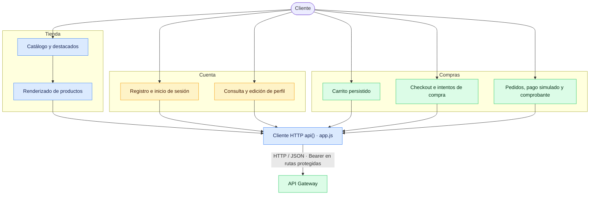

<!-- markdownlint-disable MD033 -->

# PP3 — TechStore · Frontend

Frontend original de [PabloHD2024](https://github.com/PabloHD2024/Ecommerce_Frontend_PP3), con su historial conservado. Adaptación en `pp3/gateway-frontend`, repositorio [ignaci0vidal/pp3-frontend-alternativo](https://github.com/ignaci0vidal/pp3-frontend-alternativo).

Interfaz de la tienda de comercio electrónico del proyecto de microservicios de PP3. Permite explorar productos, gestionar la cuenta y el carrito, crear pedidos, simular pagos y consultar comprobantes mediante un API Gateway.

- **Repositorio:** [pp3-frontend-alternativo](https://github.com/ignaci0vidal/pp3-frontend-alternativo).
- **Rama de adaptación:** `pp3/gateway-frontend`.
- **Dominio de referencia del frontend:** <https://pp3-frontend-alternativo.vercel.app>.
- **API Gateway configurado:** <https://pp3-ecommerce-api-gateway.onrender.com>.
- **Implementación:** sitio estático con HTML, CSS y JavaScript, sin build ni dependencias de ejecución instaladas.

## Tecnologías utilizadas

<table>
  <tr>
    <td align="center" width="120">
      
      <br /><sub><b>HTML5</b></sub>
    </td>
    <td align="center" width="120">
      
      <br /><sub><b>CSS3</b></sub>
    </td>
    <td align="center" width="120">
      
      <br /><sub><b>JavaScript</b></sub>
    </td>
    <td align="center" width="120">
      
      <br /><sub><b>Git</b></sub>
    </td>
    <td align="center" width="120">
      
      <br /><sub><b>GitHub</b></sub>
    </td>
    <td align="center" width="120">
      
      <br /><sub><b>Vercel</b></sub>
    </td>
    <td align="center" width="120">
      
      <br /><sub><b>Node.js · pruebas</b></sub>
    </td>
  </tr>
</table>

### Librerías y herramientas

`Fetch API` · `localStorage` · `AbortController` · `URLSearchParams` · `node:test` · `node:vm`

La interfaz usa **Font Awesome 6.4.2** desde CDN. Node.js se utiliza para ejecutar las pruebas; Vercel es el destino de alojamiento documentado para el sitio estático.

## Funcionalidades

| Área | Funcionalidad implementada |
| --- | --- |
| Inicio | Productos destacados y navegación entre vistas |
| Catálogo | Búsqueda por nombre, categorías dinámicas, paginación, precios y stock |
| Cuenta | Registro, inicio y cierre de sesión y recuperación de sesión |
| Perfil | Consulta y edición de nombre, apellido, DNI, teléfono y dirección |
| Carrito | Recuperación y guardado en Usuarios, modificación de cantidades y eliminación de productos |
| Checkout | Dirección de entrega, cupón opcional y seguimiento de intentos mediante clave de idempotencia |
| Pedidos | Listado propio, detalle y solicitud de cancelación |
| Pago | Simulación explícita de pago aprobado o rechazado, por tarjeta o transferencia |
| Comprobante | Consulta de comprobante no fiscal para pedidos pagados, enviados o entregados |

Los pagos son simulados: la interfaz no solicita datos bancarios. Los importes definitivos y descuentos los determina el backend.

## Arquitectura y flujo de la aplicación

El diagrama adapta el flujo funcional de la tienda: catálogo, cuenta y compras se implementan en `app.js` y comparten el cliente HTTP `api()`. Todas las solicitudes del frontend se dirigen al Gateway.



El Gateway integra los servicios de **Usuarios**, **Catálogo** y **Pedidos**. El frontend consume sus rutas públicas a través de ese punto de entrada. Las funciones del diagrama representan el código de la interfaz; su disponibilidad completa depende de las rutas y la configuración del backend.

### Diagramas de secuencia UML

La carpeta [`diagramas/`](diagramas) contiene 12 diagramas PlantUML (`.puml`) que describen los flujos de cuenta, catálogo, carrito y compras. Se pueden visualizar con cualquier visor compatible con PlantUML. Son diagramas de referencia del contrato esperado; no certifican la disponibilidad ni el comportamiento actual de los servicios desplegados.

## Estructura del repositorio

```text
pp3-frontend-alternativo/
├── css/
│   └── styles.css
├── diagramas/
│   └── DS-01 a DS-12 (.puml)
├── docs/
│   ├── auditoria-integracion-2026-11-07.md
│   ├── gateway-contract.md
│   └── revision-integral-2026-11-08.md
├── img/
├── test/
│   └── frontend.test.cjs
├── .gitignore
├── app.js
├── index.html
└── README.md
```

| Archivo o carpeta | Responsabilidad |
| --- | --- |
| `index.html` | Vistas, formularios, navegación y modales de la tienda |
| `app.js` | Estado, cliente del Gateway y lógica de cuenta, catálogo, carrito y pedidos |
| `css/styles.css` | Estilos, diseño adaptable y estados visuales |
| `img/` | Recursos gráficos de productos incluidos en el repositorio |
| `test/frontend.test.cjs` | Pruebas de los handlers reales con DOM mínimo y solicitudes interceptadas |
| `docs/` | Contrato de integración, evidencia de revisiones y pendientes |

## Ejecución local

Se necesita un navegador moderno y un servidor de archivos estáticos. Para ejecutar las pruebas, usar **Node.js 18 o posterior**.

```sh
git clone https://github.com/ignaci0vidal/pp3-frontend-alternativo.git
cd pp3-frontend-alternativo
git switch pp3/gateway-frontend
```

Abrir la carpeta con un servidor estático, por ejemplo **Live Server** de Visual Studio Code. Si se dispone de Python, también se puede ejecutar:

```sh
python -m http.server 5500 --bind 127.0.0.1
```

En ese caso, abrir <http://127.0.0.1:5500>. No se requiere `npm install` ni un paso de compilación.

Las operaciones de la tienda requieren un Gateway accesible que permita el origen local mediante CORS.

## Configuración del API Gateway

La URL pública se define al inicio de [`app.js`](app.js):

```js
const API_BASE = "https://pp3-ecommerce-api-gateway.onrender.com";
```

Para usar otro entorno, reemplazar esa URL por la dirección de su Gateway, sin barra final. La configuración está incluida en el JavaScript que recibe el navegador: debe contener únicamente la URL pública.

El cliente envía JSON y agrega `Authorization: Bearer TOKEN` cuando existe una sesión. El JWT se conserva en `localStorage` bajo `techstore_token`; un 401 en una solicitud autenticada, salvo el login, limpia la sesión. Los fallos transitorios permiten reintentar sin cerrar la sesión automáticamente.

### Rutas consumidas

| Método | Ruta | Uso |
| --- | --- | --- |
| POST | `/api/usuarios` | Registro público |
| POST | `/api/sesiones` | Inicio de sesión |
| GET / PUT | `/api/usuarios/me` | Consulta y actualización del perfil |
| GET / PUT | `/api/usuarios/me/carrito` | Recuperación y reemplazo del carrito |
| GET | `/api/productos` | Catálogo, filtros, paginación y destacados |
| GET | `/api/productos/:id` | Información actual de cada producto del carrito |
| GET | `/api/categorias` | Categorías del catálogo |
| GET / POST | `/api/pedidos` | Listado propio y creación de pedidos |
| GET | `/api/pedidos/operaciones/:attemptId` | Recuperación de una compra pendiente |
| GET | `/api/pedidos/:id` | Detalle del pedido |
| PATCH | `/api/pedidos/:id` | Solicitud de cancelación con `estado: "cancelled"` |
| POST | `/api/pedidos/:id/pagar` | Pago simulado |
| GET | `/api/pedidos/:id/comprobante` | Comprobante no fiscal |

La creación de pedidos envía `Idempotency-Key`. Ante una respuesta incierta se conserva el intento para consultarlo antes de iniciar otra compra. El carrito se vacía después de reconocer la confirmación del pedido.

Los cuerpos y formatos de respuesta se describen en el [contrato del Gateway](docs/gateway-contract.md).

## Despliegue en Vercel

El repositorio se sirve como un sitio estático:

| Campo | Configuración |
| --- | --- |
| Repositorio | `ignaci0vidal/pp3-frontend-alternativo` |
| Rama con la adaptación | `pp3/gateway-frontend` |
| Framework Preset | `Other` |
| Root Directory | Raíz del repositorio |
| Build Command | Sin comando de compilación |
| Output Directory | Raíz del sitio (`.`) |

Antes de desplegar, revisar `API_BASE`. El Gateway debe permitir el dominio del frontend y los orígenes locales utilizados, los métodos de la tabla anterior y los headers `Authorization`, `Content-Type` e `Idempotency-Key`.

## Pruebas

Desde la raíz del repositorio:

```sh
node --check app.js
node --test test/frontend.test.cjs
git diff --check
```

La suite verifica autenticación, perfil, carrito persistido, catálogo y stock, idempotencia del checkout, cancelación, pagos simulados, comprobantes, contenido HTML hostil y respuestas tardías tras cambiar de sesión.

Las pruebas ejecutan el JavaScript real en una VM con un DOM mínimo y `fetch` interceptado. Comprueban el comportamiento del frontend ante respuestas controladas; la integración con los servicios desplegados requiere una comprobación adicional en navegador.

## Estado de integración y pendientes

La [revisión integral del 08/11/2026](docs/revision-integral-2026-11-08.md) es la última evidencia de integración documentada en este repositorio. En esa revisión se registraron **38/38 pruebas aprobadas** y los siguientes bloqueos:

- **CORS:** el Gateway respondía con el origen del frontend original, diferente del dominio alternativo.
- **Producto individual:** el Gateway devolvía 404 en `/api/productos/:id`, ruta necesaria para recuperar el carrito con precios y stock actuales.
- **Recuperación de compras:** no estaba expuesta `/api/pedidos/operaciones/:attemptId`.
- **Conexión con Pedidos:** el health del Gateway devolvía 503 con Pedidos no disponible, aunque el servicio respondía a su health directo.

Estos resultados corresponden a esa fecha y no certifican el estado actual de producción. Una vez resueltos, queda verificar en navegador el recorrido completo: registro/login → perfil → carrito → pedido con dirección y cupón → recuperación tras recargar → pago simulado → comprobante y cancelación.

El carrito se reemplaza completo en cada guardado; las ediciones simultáneas desde varias pestañas o dispositivos pueden sobrescribirse.

## Documentación relacionada

- [Contrato, evidencia y pendientes del Gateway](docs/gateway-contract.md).
- [Revisión integral del 08/11/2026](docs/revision-integral-2026-11-08.md).
- [Auditoría de integración del 07/11/2026](docs/auditoria-integracion-2026-11-07.md).
- [API de Usuarios y README de referencia](https://github.com/ignaci0vidal/pp3-api-usuarios).
- [Frontend original de PabloHD2024](https://github.com/PabloHD2024/Ecommerce_Frontend_PP3).
